# 6311arts — High-Level Architecture

**Project:** Rogers Edge — rebuild of 6311arts.com
**Status:** Target architecture. Implementation follows [`docs/prompts/scrub-prompts.md`](../prompts/scrub-prompts.md) and the series beside it (see [Build status](#build-status)).
**Owner:** Robert Felkins (Architect4Hire) · Client sponsor: Holly King
**Last reviewed:** 2026-11-02

This document is the picture. The enforceable detail lives in [`CLAUDE.md`](../../CLAUDE.md) and [`.claude/rules/`](../../.claude/rules). If they disagree, the rules win, and this document gets fixed.

### Build status

The picture covers work that's built and work that's only written down as prompts. Where a section describes something that doesn't exist yet, it says which series owns it.

| Series                                                                                       | Covers                                                                                    | State                                                           |
| -------------------------------------------------------------------------------------------- | ----------------------------------------------------------------------------------------- | --------------------------------------------------------------- |
| [`scrub-prompts.md`](../prompts/scrub-prompts.md) Phases 0–3                                 | Platform, identity, CMS content, media, publishing, the site read API                     | Built                                                           |
| [`scrub-prompts.md`](../prompts/scrub-prompts.md) Phase 5                                    | Square: `SquareSync`, gateways, fake, push, webhooks, reconciler, cart, checkout, members | **Not built.** `Arts6311.Square` is empty; projections are null |
| [`scrub-prompts.md`](../prompts/scrub-prompts.md) Phase 6                                    | Publish model, CI deploy, cutover                                                         | Platform in Terraform (ADR 0060); app publish mode not built    |
| [`wordpress-import-scrub-prompts.md`](../prompts/wordpress-import-scrub-prompts.md)          | WordPress → snapshot → CMS import                                                         | Per that file                                                   |
| [`artist-accounts-scrub-prompts.md`](../prompts/artist-accounts-scrub-prompts.md) (A.1–A.15) | The `Artist` role, the artist portal, account administration in Studio                    | **Planned.** ADRs 0055–0058 claimed, not yet written            |
| [`shop-variations-scrub-prompts.md`](../prompts/shop-variations-scrub-prompts.md) (V.1–V.10) | Shop item variants, each its own SKU and Square variation                                 | **Planned.** Lands before Phase 5                               |
| [`site-analytics-scrub-prompts.md`](../prompts/site-analytics-scrub-prompts.md) (G.1–G.9)    | A provider-neutral analytics seam on the site, GA4 behind it                              | **Planned.** ADR 0059 claimed                                   |

---

## Contents

1. [Goals and constraints](#1-goals-and-constraints)
2. [System context](#2-system-context)
3. [Containers](#3-containers)
4. [The request seam and domain modules](#4-the-request-seam-and-domain-modules)
5. [The transactional outbox](#5-the-transactional-outbox)
6. [Square two-way integration](#6-square-two-way-integration)
7. [Identity, roles and the browser boundary](#7-identity-roles-and-the-browser-boundary)
8. [Account administration and the artist portal](#8-account-administration-and-the-artist-portal)
9. [Content model and lifecycle](#9-content-model-and-lifecycle)
10. [Key flows](#10-key-flows)
11. [WordPress import](#11-wordpress-import)
12. [Environments: laptop and Azure](#12-environments-laptop-and-azure)
13. [Cross-cutting concerns](#13-cross-cutting-concerns)
14. [Decisions and open items](#14-decisions-and-open-items)

---

## 1. Goals and constraints

| Goal                                  | How the architecture answers it                                                                                                                                                        |
| ------------------------------------- | -------------------------------------------------------------------------------------------------------------------------------------------------------------------------------------- |
| Get off WordPress plugin sprawl       | A **closed** CMS: every content type is code we own. No plugins, themes or page builder.                                                                                               |
| Staff publish without a developer     | Angular admin (Studio) with draft, schedule, publish and preview. Publishing refreshes the site automatically.                                                                         |
| Artists keep their own profiles fresh | An **artist portal** on the site. Artists *propose* profile changes and upload pictures; staff approve, and the approval is the write. Nothing an artist does publishes.               |
| One person runs the accounts          | The `Admin` role is the super user: invites, roles, resets, lockout, sign-out-everywhere and deactivation in Studio, all audited. No one ever types or sees another person's password. |
| Sell art, classes and memberships     | **Square** owns money and stock. The site sells on-page through the Web Payments SDK. Two-way sync keeps both sides true.                                                              |
| Never lose a sync or double-charge    | **Transactional outbox** (atomic with every write), idempotency keys on every Square call, a webhook inbox, a reconciler                                                               |
| Fast, findable public site            | Angular **SSR**. The spike's SEO (meta, JSON-LD, sitemap, 301s) is carried forward, with CDN-friendly caching.                                                                         |
| Know what visitors use                | One provider-neutral analytics seam on the site, with GA4 behind it. Nothing personal is sent, and Studio and the portal are never measured.                                           |
| Cheap to run, easy to hand over       | Small Azure Container Apps footprint. One Aspire model runs the laptop and describes the apps; Terraform owns the stateful platform.                                                   |
| Build fast and safely with AI         | Claude Code driven by SCRUB prompts, with rules, skills, reviewers and hooks in `.claude/`                                                                                             |

**Hard constraints:**

- Runs **fully on a developer laptop**, offline by default, until it's published to Azure.
- Square is reached **only** through `Arts6311.Square`.
- Card data never touches our servers.
- One public origin, through the gateway.

---

## 2. System context

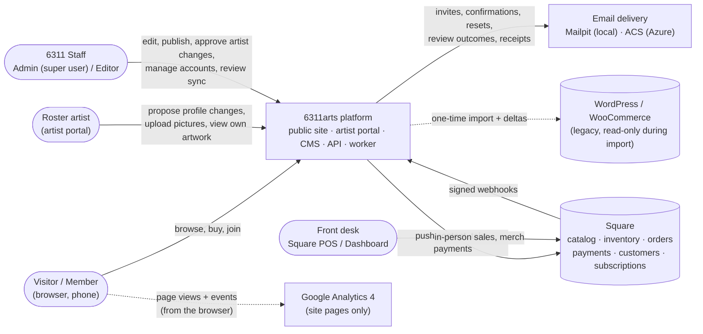

Square is shared with the front desk. In-person sales made there flow back to the website through webhooks. Price and quantity changes for website items are made in the CMS as audited commands (ADR 0032). Merch is sold only through Square POS.

---

## 3. Containers

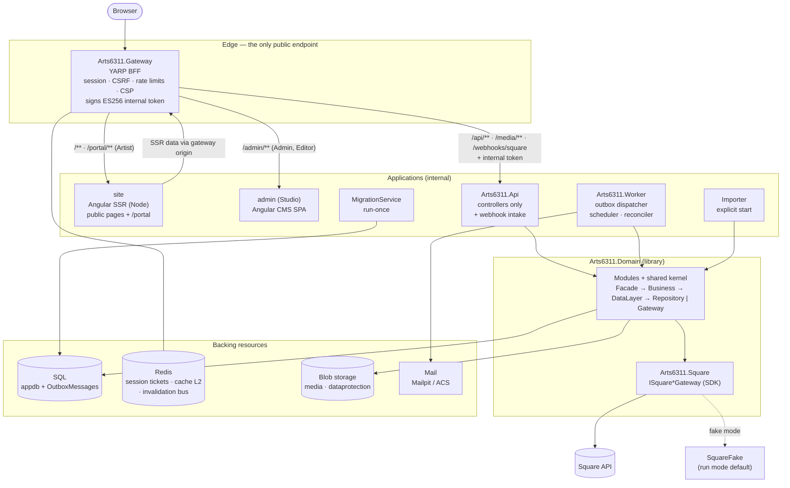

| Container            | Responsibility                                                                                                                                                                                           | Never does                                                                   |
| -------------------- | -------------------------------------------------------------------------------------------------------------------------------------------------------------------------------------------------------- | ---------------------------------------------------------------------------- |
| **Gateway**          | Routing, BFF session, antiforgery, header stripping, internal token, CSP, rate limits, compression. Gates `/admin/**` (`CmsEditor`) and `/portal/**` (`ArtistPortal`)                                    | Business logic, data access, Square calls                                    |
| **site**             | SSR pages, SEO, JSON-LD, sitemap, legacy redirects, `/signin`, emailed-link pages, cart and checkout UI (Web Payments SDK), the **artist portal** (`/portal`, `no-store`, `noindex`), the analytics seam | Hold secrets; call anything but the gateway; send personal data to analytics |
| **admin** (Studio)   | CMS screens, media library, the artist-change review queue, **People** (account administration, Admin only), sync and import operations views                                                            | Store tokens; edit Square-owned values; show or accept a password; analytics |
| **Api**              | HTTP surface: controllers → facades; webhook intake (verify → inbox → outbox)                                                                                                                            | Domain logic; provider calls inside a request that could follow the commit   |
| **Worker**           | Drains the outbox (keyed handlers), runs scheduled publishing and the reconciler, plus cleanup                                                                                                           | Accept HTTP traffic                                                          |
| **Domain**           | All modules, the shared kernel, `ArtsDbContext`, migrations                                                                                                                                              | Reference the Square SDK                                                     |
| **Square**           | Implements `ISquare*Gateway` with the official SDK; money mapping                                                                                                                                        | Leak SDK types                                                               |
| **MigrationService** | Apply migrations, seed roles, the first Admin and the content seed, exit, before api and worker start                                                                                                    | Run in the request path; seed an artist account                              |
| **Importer**         | WordPress → snapshot → stage → load through facades → verify                                                                                                                                             | Write WordPress; publish; call Square (except the read-only match)           |

The portal is part of the **site** bundle, not a third app. The gateway gates it like `/admin`. Like `/admin`, the route that serves its bundle is deliberately not token-bearing; its API calls go through `/api/v1/artist/**`, which is (A.5).

---

## 4. The request seam and domain modules

Every HTTP feature and every worker handler follows one seam (`.claude/rules/backend.md`):

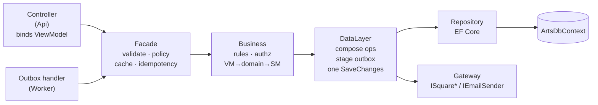

- **ViewModels in, ServiceModels out.** EF entities and Square DTOs never cross the controller boundary.
- **Handlers re-enter through facades.** Worker outbox handlers go through the same facades as controllers, so rules and validation apply in both places.
- **The caller's identity comes from the token, never the request.** The artist routes resolve "which artist" from the token's `sub` through `ArtistAccount`; no route parameter, body field or header can change it (A.9).

**Domain modules** (`Modules/<Context>/`, one assembly, one `DbContext`). Modules in *italics* are planned.

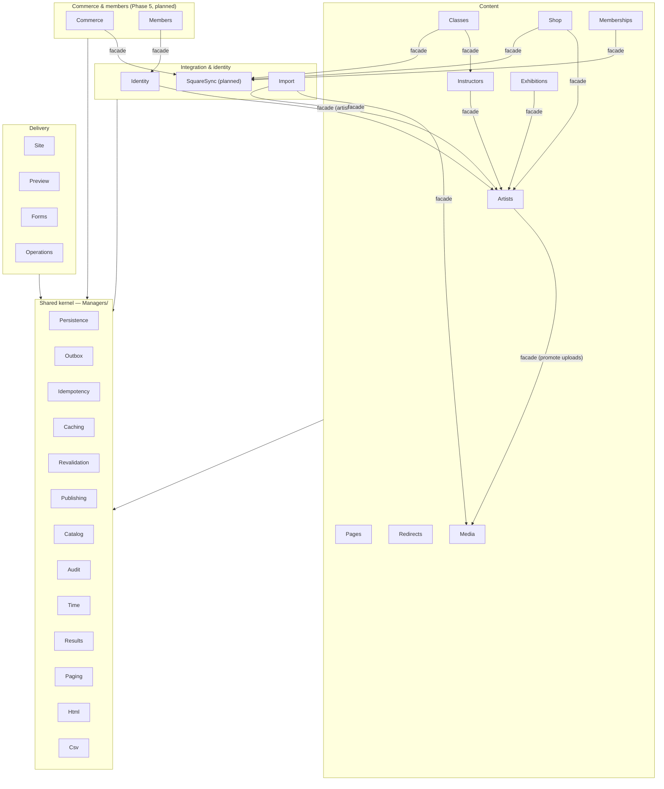

- **Cross-module traffic is facade to facade only.**
- **The shared kernel depends on no module.** `Catalog` holds the shared SKU registry (`CatalogSkus`, ADR 0037).
- **`ModuleBoundaryTests` enforce both rules.**
- **The artist portal adds no module.** `ArtistAccount` and `ArtistProfileChange` live in **Artists**; the `ArtistUpload` media kind lives in **Media**; account administration lives in **Identity** (artist-accounts series).

---

## 5. The transactional outbox

Every side effect that must follow a commit is an outbox message:

- Square pushes, price and quantity commands, and seat adjustments
- processing inbound webhooks
- emails, including invites, resets and artist review outcomes
- media renditions, publishing and purges
- site revalidation and slug-change redirects

The SQL table **is** the queue, so there's no broker. 

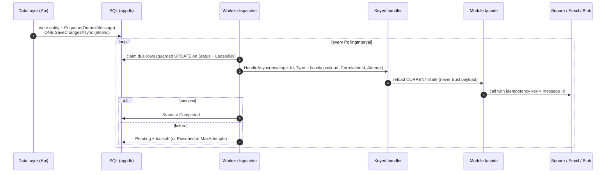

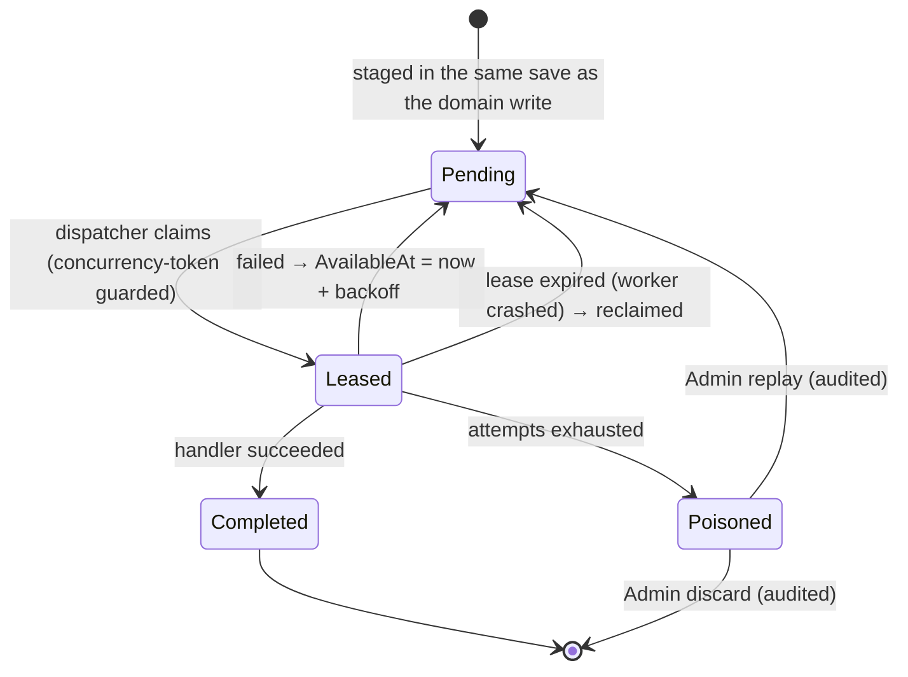

| Message type                                          | Raised by                                                                                                        | Handled by                                            |
| ----------------------------------------------------- | ---------------------------------------------------------------------------------------------------------------- | ----------------------------------------------------- |
| `square.catalog-push-requested` / `-delete-requested` | Publish / update / archive of a synced type                                                                      | SquareSync: push current content to Square            |
| `square.price-change-requested`                       | Change-price command (`SquareChangeRequest`, compare-and-set), per variation                                     | SquareSync                                            |
| `square.inventory-change-requested`                   | Set-quantity command (`PHYSICAL_COUNT`) or a class-run capacity change (`ADJUSTMENT`)                            | SquareSync                                            |
| `square.webhook-received`                             | Webhook intake (after inbox insert)                                                                              | SquareSync / Members: fetch current state from Square |
| `media.rendition-requested`                           | Staff upload, form submission, **artist upload**, import                                                         | Media: 400 / 800 / 1600 WebP + JPEG                   |
| `media.publish-requested`                             | Publishing a record with images; **approving an artist change** that promotes uploads                            | Media: mark the images `Published` (one way)          |
| `media.purge-requested`                               | Media delete                                                                                                     | Media                                                 |
| `email.send-requested`                                | Forms, Identity (confirmations, resets, **invites**), **artist change submitted / reviewed**, checkout, renewals | Notifications via `IEmailSender`                      |
| `redirect.slug-changed`                               | A published slug changing                                                                                        | Redirects                                             |
| `site.revalidate-requested`                           | Any publish change, every artist edit (**including an approved artist change**), or a Square projection change   | Cache-tag invalidation                                |

Invite and reset tokens are minted by the email composer at send time. They never appear in a payload (auth.md). An artist-change email carries the request id and nothing else (A.11).

**Guarantees:**

- At-least-once delivery, with idempotent handlers.
- A crash at any point loses nothing and duplicates no external effect.
- Two Worker replicas are safe.

---

## 6. Square two-way integration

*Phase 5. Not built yet. Until it is, every projection is null and every item reads as before its first sync (ADR 0038, 0042).*

### The website catalog (ADR 0032)

- **Artwork (`ShopItem`) and classes (`ClassOffering` / `ClassRun`, ADR 0044)** are created in the CMS and pushed to Square. Staff never manage them in Square.
- **Merch is POS-only.** It has no CMS type, no site page and no import mapping.
- **Square objects with no CMS id custom attribute are POS-only.** Inbound handlers and the reconciler ignore them.

### Field ownership

| CMS-owned → pushed on every content push                                | Square holds the record → pulled into projections                                | CMS *requests* a change (command → outbox)                              |
| ----------------------------------------------------------------------- | -------------------------------------------------------------------------------- | ----------------------------------------------------------------------- |
| Name, description, artist, categories, images, publish/archive state    | Price                                                                            | Artwork variant and class run price: **change price** (compare-and-set) |
| **SKU** (per shop variant, per class run; unique through `CatalogSkus`) | Stock, seats remaining, sold out                                                 | Artwork variant quantity: **set quantity** (`PHYSICAL_COUNT`)           |
| Variant name, option values, position, image                            | Orders, payments, refunds, taxes, customers, cards, subscriptions, member status | Class run capacity → seat `ADJUSTMENT` by the difference                |
| Class details, run instructor, session times, run capacity              | Plan price and cadence after creation                                            | — (no change-price command for a plan, ADR 0005)                        |
| Membership plan copy and perks; the starting price and cadence          |                                                                                  |                                                                         |

Starting price and stock (or capacity) are draft fields until the first push creates the Square object. After that they're frozen, and per variant or per run: one sold variant doesn't freeze its siblings. Every command is a `SquareChangeRequest` row plus one outbox message in the same save, and is audited. **Artists never reach any of this.** The portal reads their own artwork's projections, labelled as Square's, and has no command, form or action (A.14).

### Mapping

| CMS                            | Square                                                                                                                                                                                                             |
| ------------------------------ | ------------------------------------------------------------------------------------------------------------------------------------------------------------------------------------------------------------------ |
| `ShopItem` / `ShopItemVariant` | One `ITEM` / one `ITEM_VARIATION` per variant. An item with no variations is one unnamed variant. One-of-a-kind is one variant at quantity 1. Whether option axes become `ITEM_OPTION` objects is **DECIDE** (V.1) |
| `ClassOffering` / `ClassRun`   | `ITEM` / one `ITEM_VARIATION` per run (inventory = seats). Sessions are times only (ADR 0044)                                                                                                                      |
| `MembershipPlan`               | `SUBSCRIPTION_PLAN` + `SUBSCRIPTION_PLAN_VARIATION`                                                                                                                                                                |
| Images                         | `IMAGE`, uploaded by the push handler                                                                                                                                                                              |
| Link between them              | `SquareCatalogLink` (Square ids, variation ids mapped per variant / run, version, content hash, status). The CMS id is stored as a Square custom attribute.                                                        |

### Two directions, one mechanism

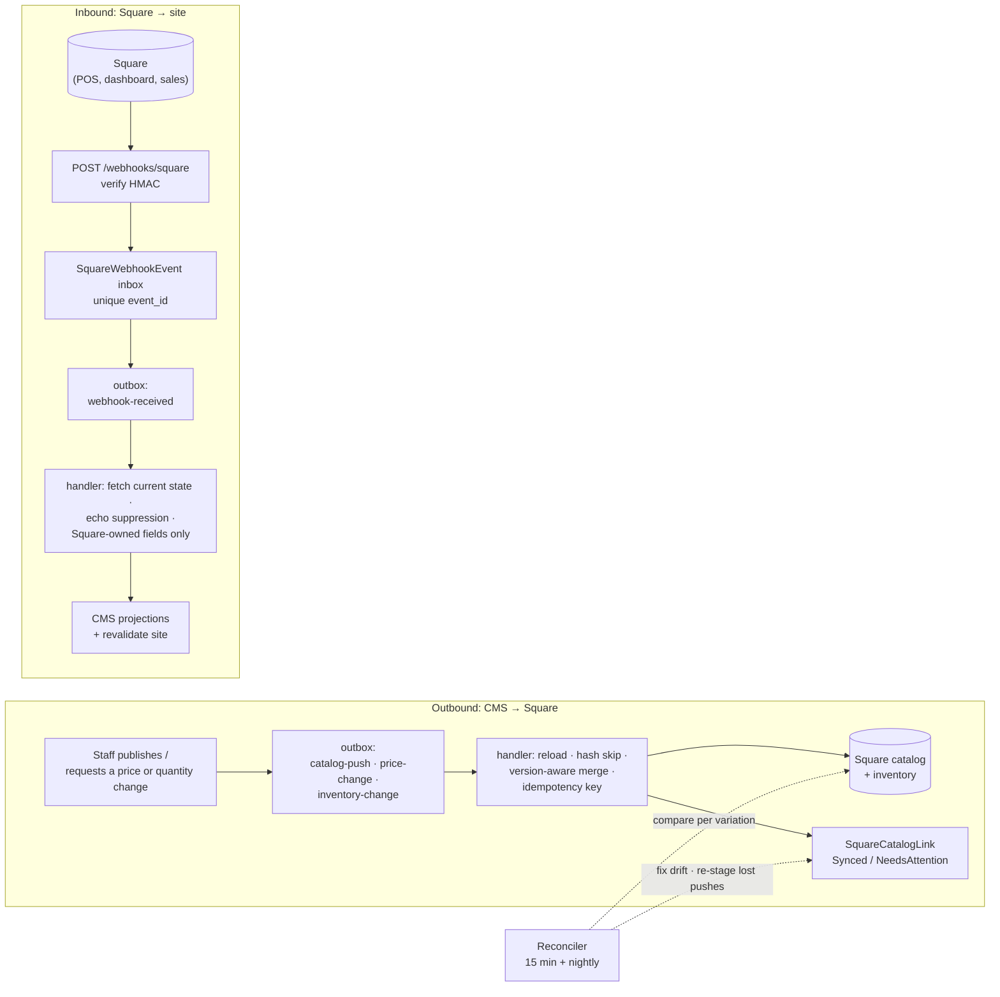

**Safety rules:**

- Webhook payloads are never trusted.
- Our own pushes echoing back are ignored.
- Objects created in Square with no CMS id are ignored, never imported as drafts (ADR 0032).
- Objects deleted in Square are flagged, never hard-deleted in the CMS. The archive policy is **DECIDE** (0011).
- In run mode, everything runs against `Arts6311.SquareFake` by default. Sandbox is opt-in, and production is unreachable.

---

## 7. Identity, roles and the browser boundary

The gateway-to-API trust model is baseline B-02/B-13, adopted as-is (`.claude/rules/auth.md`, `gateway.md`). There's **no two-factor authentication for anyone** (ADR 0018). Login is a single step, so the compensating controls below are mandatory.

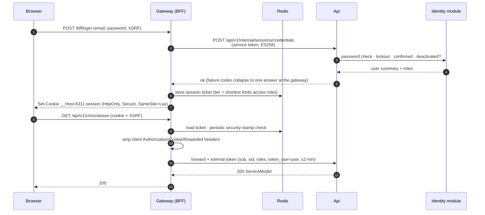

### Roles

| Role                     | Surface and policy                                         | Can                                                                                                                                                      | Confirmed email | Password floor | Session (idle / absolute) |
| ------------------------ | ---------------------------------------------------------- | -------------------------------------------------------------------------------------------------------------------------------------------------------- | --------------- | -------------- | ------------------------- |
| `Admin` (the super user) | `/admin/**`, `/api/v1/cms/**` — `CmsEditor` and `CmsAdmin` | Everything an Editor can, plus deletes and restores, seat adjustments, outbox replay/discard, redirects, CSV exports and **account administration** (§8) | yes             | 14             | 30 min / 8 h              |
| `Editor`                 | `/admin/**`, `/api/v1/cms/**` — `CmsEditor`                | CMS content and media; reviews artist profile changes                                                                                                    | yes             | 14             | 30 min / 8 h              |
| `Artist` *(planned)*     | `/portal/**`, `/api/v1/artist/**` — `ArtistPortal`         | Their own profile (as **proposals**), uploads within a quota, their own artwork read-only, their own display name and password                           | yes             | 14             | 30 min / 12 h             |
| `Member` *(Phase 5)*     | the member area — `Member`                                 | Subscription status, card update, cancel                                                                                                                 | no              | 8              | 7 days / 30 days          |
| anonymous                | public site                                                | Reads, cart, quote, pay, forms (rate limited), `/signin`, emailed-link pages, accepting an invite                                                        | —               | —              | —                         |

**The super user is today's `Admin`, not a fifth role.** auth.md already gives `Admin` user management. The artist-accounts series builds the seam and screens behind the existing `CmsAdmin` policy instead of splitting the role (ADR 0056).

**`Artist` is not staff.** `IdentityRoles.Staff` stays `Admin` + `Editor`, so an artist session gets a 403 on `/admin/**` and `/api/v1/cms/**`, and Studio's nav never renders for one. An artist is held to the staff password floor and a confirmed address because an artist account can change what the site says under someone's name. The password rule reads `IdentityRoles.StrongPassword` = `Admin`, `Editor`, `Artist` (ADR 0055).

**A combined session takes the shortest of every limit its roles carry.** `Admin` + `Artist` gets 8 h, and `Artist` + `Member` gets the Artist limits. Role changes move the absolute deadline forward only.

**Rules:**

- No tokens ever reach the browser. Emailed-link and invite tokens travel in the URL **fragment** and are posted in a body (ADR 0029).
- `/api/v1/internal/**` returns 404 from browsers.
- The API accepts only the gateway's internal token.
- Staff passwords are at least 14 characters, everyone's at least 8, all checked against a bundled breached list offline. Lockout, the `/bff/login` rate limit and staff sign-in auditing are never relaxed without an ADR.
- "Log out everywhere" rotates the security stamp. Every other session ends at its next revalidation (≤ 5 minutes).
- `/signin` is on the site and is never behind a session gate. Staff and artists both use it; `?returnUrl=/portal` takes an artist home.

---

## 8. Account administration and the artist portal

*Planned — [`artist-accounts-scrub-prompts.md`](../prompts/artist-accounts-scrub-prompts.md), A.1–A.15, ADRs 0055–0058.*

### Account administration (the super user's half)

An `Admin` manages every account from Studio's **People** section. The section is Admin only: an Editor sees neither the nav entry nor the route.

| Operation                           | Route (`CmsAdmin`)                                   | Notes                                                                                   |
| ----------------------------------- | ---------------------------------------------------- | --------------------------------------------------------------------------------------- |
| List, search, filter                | `GET /api/v1/cms/users`                              | State: Invited / Active / Locked / Deactivated                                          |
| Invite                              | `POST /api/v1/cms/users`                             | Creates an account with **no password** and stages the invite email                     |
| Read, update                        | `GET` / `PATCH /api/v1/cms/users/{id}`               | Display name, address, roles, artist link. `If-Match` required (428 missing, 409 stale) |
| Password reset, resend confirmation | `POST …/{id}/password-reset`, `…/email-confirmation` | Sends a link. Never sets, returns or logs a password                                    |
| Lock / unlock                       | `POST …/{id}/lock`, `…/unlock`                       | Identity lockout                                                                        |
| Sign out everywhere                 | `POST …/{id}/sessions/revoke`                        | Rotates the security stamp                                                              |
| Deactivate / reactivate             | `POST …/{id}/deactivate`, `…/reactivate`             | **Never delete.** Audit rows and `UpdatedBy`/`DeletedBy`/`ReviewedBy` point at user ids |

**Guards** (each its own error code and test): `identity.self_administration` (nobody changes their own roles, lockout or deactivation), `identity.last_admin`, `identity.protected_account` (the seeded admin), `identity.artist_link_required` and `identity.email_taken`. Every operation writes an audit row. Deactivating an account or changing its address rotates its stamp.

The invited person sets their own password at `/account/accept-invite` on the site. The token is read from the fragment, posted to `/bff/accept-invite`, and spent once.

### The artist portal (the artist's half)

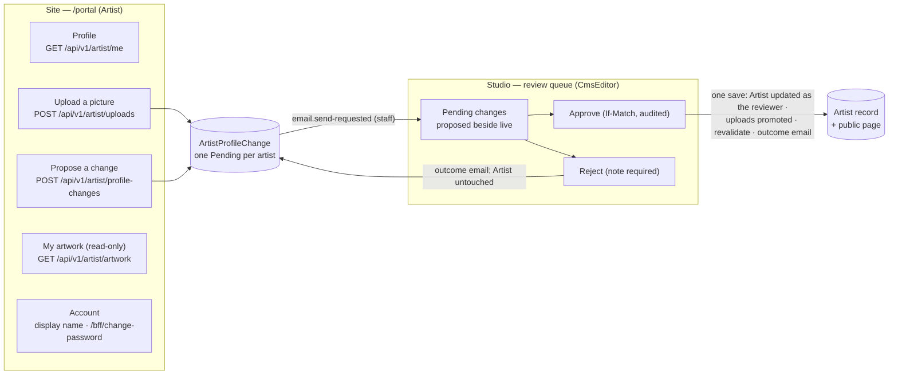

**Who may write what:**

| Record                                         | Studio (`Editor` / `Admin`)   | Portal (`Artist`)                                          |
| ---------------------------------------------- | ----------------------------- | ---------------------------------------------------------- |
| `Artist` (bio, medium, portrait, slug, status) | writes, publishes             | **never**. Proposes an `ArtistProfileChange`               |
| `ArtistProfileChange`                          | approves, rejects             | creates or replaces their pending one; withdraws their own |
| `MediaAsset` (`ArtistUpload` kind)             | reviews; promoted on approval | uploads within a quota, `Draft` only, alt text required    |
| `ShopItem` content, SKU, starting figures      | writes                        | **never**. Reads their own, no fields                      |
| Square projections (price, stock, sold out)    | never (square.md)             | never                                                      |
| `ArtsUser`, roles, lockout, sessions           | `Admin` only, audited         | own display name and password only                         |

**Design points:**

- **A profile edit is a reviewed request, not a write.** It's the same shape as `SquareChangeRequest` (ADR 0032). The approval is a staff write that changes content, never status: a Draft artist stays Draft and a Published one stays Published. It stages `site.revalidate-requested` either way. Slug and name changes aren't proposable (ADR 0057).
- **The account ↔ artist link is its own record.** `ArtistAccount` has `ArtistId` and `UserId`, each unique, so there's one account per artist and one artist per account. There's no user id on the `Artist` content entity (ADR 0055).
- **Uploads are a new media kind beside `Submission`.** They're always `Draft`, have their own byte cap and per-artist quota, and stay out of the staff library list. An artist sees only their own; staff see all. They're published only by an approval (ADR 0058).
- **The portal is private.** It's `noindex`, `Cache-Control: no-store`, never prerendered, `Disallow: /portal` in robots.txt, never sent to analytics, and has its own `artist` rate limit. An unauthenticated visit redirects to `/signin?returnUrl=/portal`; a Member or Editor session gets a 403.
- **A password change needs the current password.** `/bff/change-password` rotates the stamp, ending every other session and re-issuing this one.

---

## 9. Content model and lifecycle

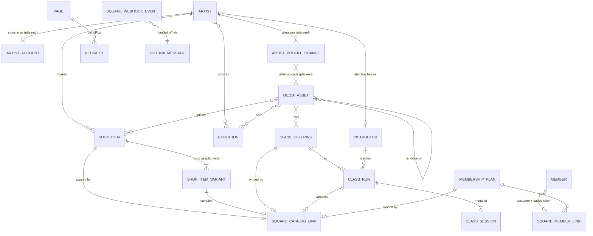

- **Shop variants** (shop-variations series) move the SKU, starting price, starting stock and projections off `ShopItem` onto `ShopItemVariant`, the same shape as offering → run (ADR 0044). Option axes come from a fixed allow-list (`size`, `colour`, `material`) with staff-typed values. Duplicate combinations are refused, and one-of-a-kind and more than one variant are mutually exclusive.
- **`ArtistAccount`** links an Identity user id to an artist. It's the only place the two meet.

Publishable content (artists, instructors, exhibitions, classes, shop items, plans, pages) shares one lifecycle:

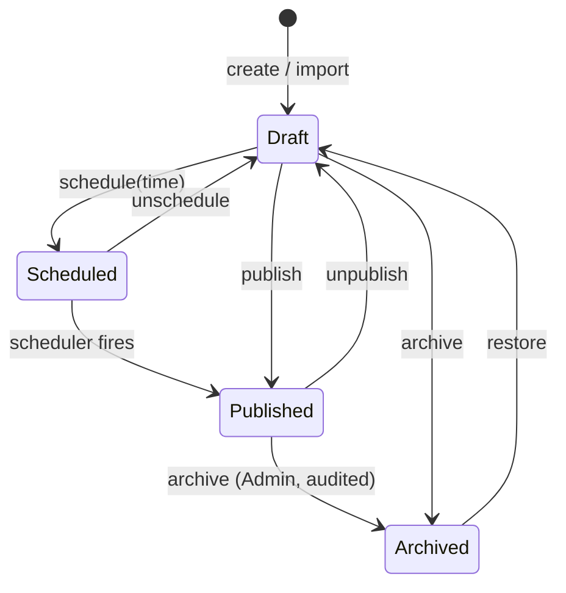

Every transition stages `site.revalidate-requested`. Synced types also stage the matching `square.*` message. Every artist edit revalidates, published or not, and that includes an approved portal change. **An approved artist profile change is the one content write that starts outside the CMS.** It changes content, never lifecycle state.

**Deletion** is separate from the lifecycle (ADR 0052). It's a soft delete behind one global query filter, it's Admin only and audited, and a restore comes back as a draft.

**Slugs** are made from the name, never typed (ADR 0054), and are immutable once published; a change creates a `Redirect`.

**Previews** use signed, expiring, `noindex` links that render the real page component (ADR 0063).

---

## 10. Key flows

### 10.1 Page render (SSR)

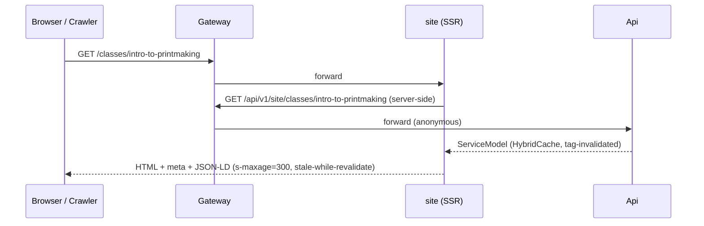

In the browser, the analytics seam records a page view from the **router's** path, with no query string and no fragment, and `/preview/{token}` redacted. `/portal/**` is never recorded.

### 10.2 Checkout (Web Payments SDK)

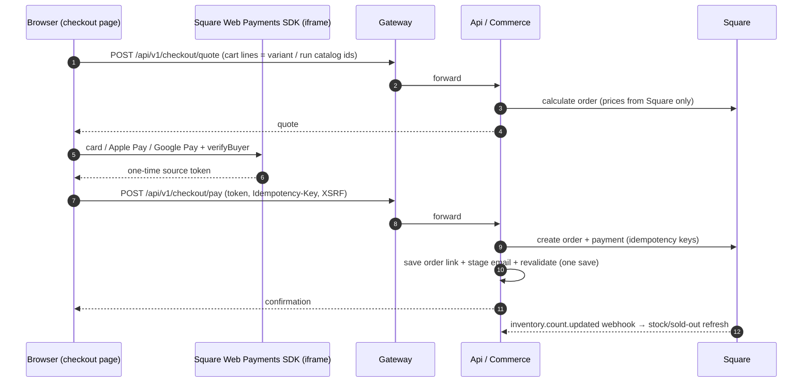

Amounts never come from the browser. The token is used once and never stored. CSP allows Square's origins only on checkout routes.

### 10.3 Membership signup

The member signs in (Member role) and the SDK tokenizes the card. Then the API:

1. finds or creates the Square customer
2. stores the card on file
3. creates the subscription (an idempotent command)

Member status stays **Pending** until `subscription.*` webhooks confirm it. Renewal failures arrive through invoice and payment webhooks, which flag the member and stage an email.

### 10.4 Inviting an artist and their first profile change

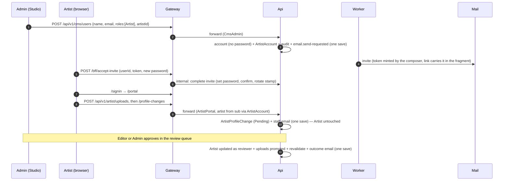

---

## 11. WordPress import

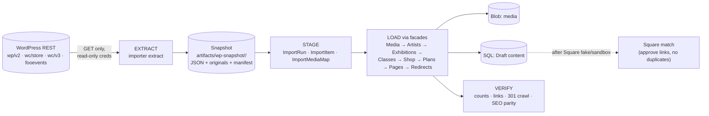

**How the import behaves:**

- **Immutable snapshots.** Every run reads a snapshot that's never changed after it's written.
- **Idempotent.** Records are keyed on their WordPress id. Staff-edited records are flagged for review, never overwritten.
- **Drafts only.** Everything lands as Draft. WooCommerce prices and stock fill only the *starting* fields.
- **No accounts.** The import creates no user, artist account or member login; customer passwords are never migrated. Artist accounts are made by invitation (§8).

Details are in `.claude/rules/import.md` and [`docs/prompts/wordpress-import-scrub-prompts.md`](../prompts/wordpress-import-scrub-prompts.md).

---

## 12. Environments: laptop and Azure

One Aspire AppHost describes the applications in both modes. Azure-shaped resources run as containers or emulators locally. In Azure, **Terraform owns the stateful platform and Aspire owns the apps**, with `terraform output` as the contract between them (ADR 0060).

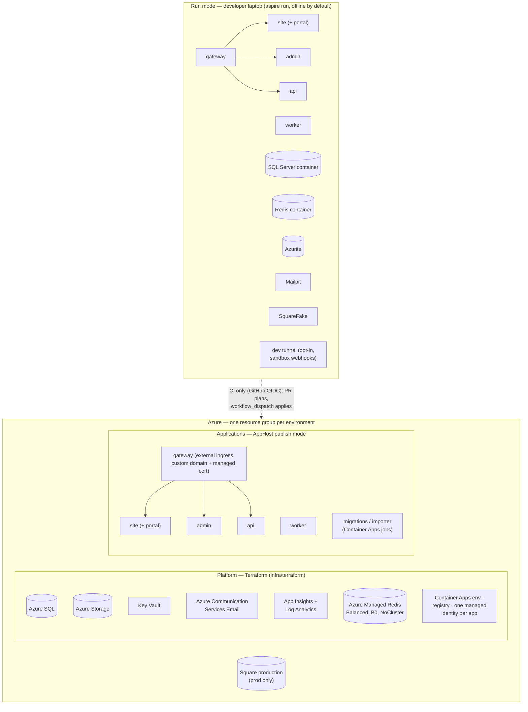

|           | Laptop (run mode)                                 | Azure dev                      | Azure prod                        |
| --------- | ------------------------------------------------- | ------------------------------ | --------------------------------- |
| Square    | Fake (default) / sandbox                          | Sandbox                        | Production                        |
| Scaling   | n/a                                               | Scale to zero (except gateway) | Min 1: gateway, api, site, worker |
| Secrets   | Generated + user-secrets                          | Key Vault                      | Key Vault                         |
| Redis     | Container                                         | Managed Redis, no persistence  | Managed Redis, AOF + replica      |
| Analytics | Inert (no measurement id) or the dev GA4 property | Dev GA4 property               | Prod GA4 property                 |
| Deploy    | —                                                 | CI                             | CI with manual approval           |

The seeded first `Admin` comes from secret AppHost parameters (`seed-admin-email`, `seed-admin-password`). Every other account, artists included, is made by invitation from Studio. There's no seeded artist account.

**Rough hosting cost** (from the Rogers Edge plan; the outbox replaced Service Bus):

- about $20/mo for dev
- about $85–100/mo for prod
- plus Azure Managed Redis per environment. It's materially more than the retired `C0` the plan costed, so this estimate needs redoing (ADR 0061)
- plus Square fees per sale

---

## 13. Cross-cutting concerns

| Concern             | Approach                                                                                                                                                                                                                                                                                                                                                                                                            |
| ------------------- | ------------------------------------------------------------------------------------------------------------------------------------------------------------------------------------------------------------------------------------------------------------------------------------------------------------------------------------------------------------------------------------------------------------------- |
| **Observability**   | OpenTelemetry via ServiceDefaults. The correlation id is the W3C trace id (ADR 0019) and flows browser → gateway → api → outbox row → handler → Square. Log scopes aren't exported; preview tokens are redacted from spans. Alerts: Poisoned > 0, outbox age > 5 min, webhook signature failures, 5xx rate.                                                                                                         |
| **Caching**         | HybridCache (in-memory L1, Redis L2) with tags invalidated by `site.revalidate-requested` and broadcast to every process over a Redis invalidation bus (ADR 0049). SSR `s-maxage` + `stale-while-revalidate` at the edge. Portal and Studio responses are `no-store`.                                                                                                                                               |
| **Resilience**      | ServiceDefaults resilience on HTTP clients. Square writes only from outbox handlers (retry with backoff → poison → admin replay). Reconciler as the safety net.                                                                                                                                                                                                                                                     |
| **Security**        | Single origin; BFF cookie; antiforgery; ES256 internal token; header stripping; rate limits (including `artist` and `bff-account`); CSP by `sha256-` hash, no nonce (ADR 0039); HTML sanitizer; signature-checked uploads; no public blobs; no 2FA, so 14-character staff and artist passwords, lockout and short sessions (ADR 0018); no administrator-set passwords; deactivate, never delete; secret-guard hook. |
| **Data protection** | No card data stored. Newsletter imported only with consent. Customer passwords never migrated. Snapshots with personal data deleted after cutover. Analytics never receives an address, name, user id, member or artist status, form answers, `location.href`/`search`/`hash`, or any `/portal` page; Google Signals and ad personalization stay off.                                                               |
| **Analytics**       | *Planned* (site-analytics series). A provider-neutral `Analytics` service in the site with a GA4 sink behind it. `gtag.js` is injected by TypeScript, never an inline script. Page views come from router navigation. It's inert on the server and without a measurement id. No consent banner; a privacy-page disclosure and a `ConsentState` seam stand in. Nothing in Studio or `@6311/ui`.                      |
| **Contracts**       | `/api/v1`; ProblemDetails with stable codes; `ETag`/`If-Match`; `Idempotency-Key`; OpenAPI snapshot test; Angular models checked against it. The shop-variants break stays in v1, as the class-runs break did (ADR 0044).                                                                                                                                                                                           |
| **Testing**         | Per-layer tests (mock the layer below); real-DB outbox atomicity tests; Square contract suite against the fake (sandbox opt-in); Aspire end-to-end test, which will walk invite → portal → approval → deactivation (A.15); Playwright for UI and redirects.                                                                                                                                                         |
| **Delivery**        | Claude Code + SCRUB prompts; `.claude/` rules, skills, read-only reviewers and hooks. Deploys only via CI.                                                                                                                                                                                                                                                                                                          |

---

## 14. Decisions and open items

The decisions that shape this picture. The full index is [`docs/adr/README.md`](../adr/README.md).

| ADR   | Decision                                                                                          | Status                                                        |
| ----- | ------------------------------------------------------------------------------------------------- | ------------------------------------------------------------- |
| 0001  | Single-origin YARP gateway as BFF (custom host, not the Aspire YARP container)                    | Decided                                                       |
| 0002  | Gateway session + ES256 internal token; no OIDC server                                            | Decided (creatorpantry B-02/B-13)                             |
| 0003  | SQL transactional outbox; no message broker                                                       | Decided                                                       |
| 0004  | Module-first Domain + mandatory seam                                                              | Decided                                                       |
| 0005  | Square field ownership                                                                            | Decided; artwork and class price and stock superseded by 0032 |
| 0006  | Square ids in `SquareCatalogLink`, not entities                                                   | Decided                                                       |
| 0007  | Square fake by default, sandbox opt-in                                                            | Decided                                                       |
| 0008  | Run mode offline; publish to Azure Container Apps                                                 | Decided; platform split by 0060                               |
| 0009  | Redis for session tickets                                                                         | Decided; Azure hosting by 0061                                |
| 0010  | CSoon template license covers this use                                                            | **DECIDE** before launch                                      |
| 0011  | Square archive policy (delete vs mark unavailable)                                                | **DECIDE** (5.5)                                              |
| 0012  | Square subscription limits (no ACH, $1 minimum)                                                   | Record (5.10)                                                 |
| 0013  | Member class discount mechanism                                                                   | **DECIDE** (5.19)                                             |
| 0017  | Database-level immutability for the audit log                                                     | **DECIDE** before production                                  |
| 0018  | No two-factor authentication; compensating controls                                               | Decided                                                       |
| 0032  | Website items managed from the CMS; price and quantity as commands; merch stays in Square POS     | Decided                                                       |
| 0043  | Instructors are their own content type                                                            | Decided                                                       |
| 0044  | Classes are offering → runs → sessions; the run is the Square variation                           | Decided                                                       |
| 0052  | Soft delete for every CMS content type                                                            | Decided                                                       |
| 0055  | The `Artist` role and the artist portal                                                           | Planned (A.1)                                                 |
| 0056  | Account administration in Studio: `Admin` is the super user, invite-only, deactivate never delete | Planned (A.1)                                                 |
| 0057  | Artist profile changes as reviewed requests                                                       | Planned (A.1)                                                 |
| 0058  | Artist uploads as a `Draft`-only media kind with a quota                                          | Planned (A.1)                                                 |
| 0059  | Site analytics: provider-neutral seam, GA4, no banner                                             | Planned (G.1)                                                 |
| 0060  | Terraform owns the Azure platform, Aspire owns the applications                                   | Decided                                                       |
| 0061  | Azure Managed Redis, non-clustered, one instance per environment                                  | Decided                                                       |
| *tbd* | Shop item variants (V.1 claims 0062, which is now taken; renumber when written)                   | Planned (V.1)                                                 |
| —     | Newsletter vendor (export only until chosen)                                                      | **DECIDE**                                                    |

**Open items the planned series will record as `DECIDE`:**

- **Artist accounts:**
  - The invite token's lifetime (7 days, single use, is the recommendation) and whether a lapsed invite is re-sent or re-created.
  - Whether an Editor may resend a confirmation (resets stay Admin).
  - Whether an Admin-initiated address change notifies the old address.
  - Whether an artist may ever propose a name or slug change.
  - A temporary-password escape hatch is deliberately absent and would need its own ADR.
- **Shop variants:**
  - Whether option axes become Square `ITEM_OPTION` objects or variations keep a composed name.
  - Whether the CSV import groups rows into one item.
  - Whether `ItemNumber` survives.
- **Analytics:**
  - Honouring Global Privacy Control / Do Not Track.
  - Whether `/signin` and `/account/**` are counted.
  - Where the purchase de-duplication marker lives.

ADRs live in `docs/adr/` and are created by the prompts named above.
